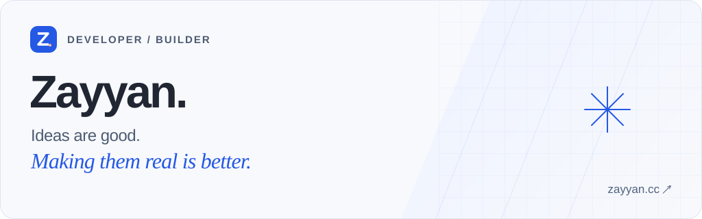
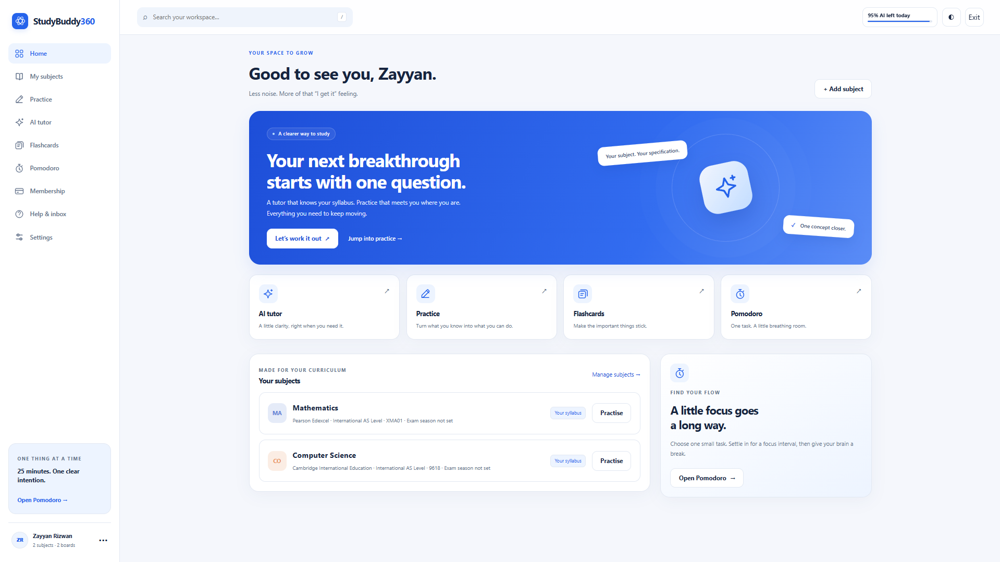

<a href="https://zayyan.cc">
  <picture>
    <source media="(prefers-color-scheme: dark)" srcset="assets/banner-dark.svg">
    
  </picture>
</a>

# Hey, I'm Zayyan.

I'm a 16-year-old developer who enjoys building useful web products, thoughtful interfaces, and AI-powered tools. I like taking an idea through the whole process: figuring out the problem, building the product, and putting it on the web.

**[Portfolio ↗](https://zayyan.cc)** &nbsp; / &nbsp; **[LinkedIn ↗](https://www.linkedin.com/in/zayyanrizwan/)** &nbsp; / &nbsp; **[Email ↗](mailto:zayyan@zayyan.cc)**

## On my desk: StudyBuddy360

A study workspace that brings subjects, syllabus-aligned practice, AI tutoring, flashcards, and Pomodoro sessions together. The idea is simple: spend less time organising your studying and more time actually learning.

I work on the design, development, and deployment, with Python, Django, JavaScript, PostgreSQL, and Docker.

**[Try StudyBuddy360 ↗](https://studybuddy360.com)** &nbsp; / &nbsp; [See the project on my portfolio ↗](https://zayyan.cc/#projects)

## What I work with

| Area | Tools |
| --- | --- |
| Backend | Python · Django · PostgreSQL |
| Frontend | JavaScript · HTML · CSS |
| Deployment | Docker · Nginx |

I'm especially interested in web development, AI-powered tools, automation, and the small interface details that make a product easier to use.

## Earlier experiments

| Project | What I explored |
| --- | --- |
| [Instagram username bot](https://github.com/zayyanr/instausernamesbot) | Python automation and web scraping to check username availability. |
| [Roblox username bot](https://github.com/zayyanr/robloxusernamesbot) | Working with APIs and username availability in Python. |
| [YouTube AdBlock](https://github.com/zayyanr/YouTube-AdBlock) | Building a Chrome extension with JavaScript. |

## Let's build something useful.

Have a project in mind, a question, or an idea to swap? Reach me at **[zayyan@zayyan.cc](mailto:zayyan@zayyan.cc)** or connect on **[LinkedIn](https://www.linkedin.com/in/zayyanrizwan/)**.

---

*Always learning. Usually building something.*
